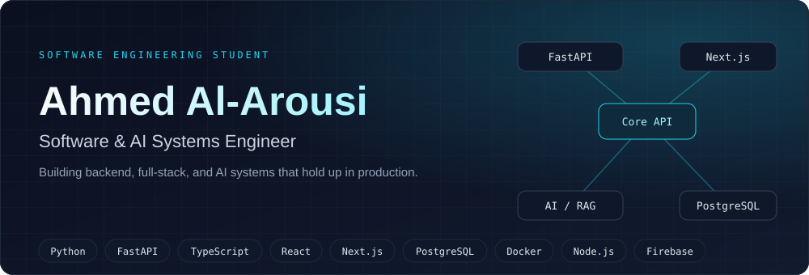
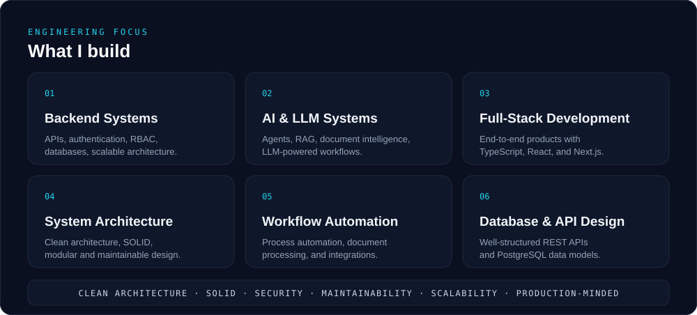
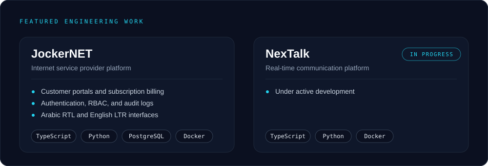

 

---

## About

I'm a Software Engineering student and Software & AI Systems Engineer focused on building reliable, scalable, and production-oriented software.

My work spans backend engineering, full-stack development, AI-powered systems, and workflow automation. I enjoy turning complex requirements into clean architectures, well-structured APIs, and practical products that solve real problems.

My core interests include backend systems, REST APIs, scalable application architecture, AI agents, RAG and document intelligence, automation, and cloud-ready software. I primarily work with Python, FastAPI, PostgreSQL, TypeScript, React, Next.js, Docker, and modern AI tooling.

I care about clean architecture, SOLID principles, security, maintainability, and building systems that can grow beyond the prototype stage.

---

## Engineering Focus

---

## Tech Stack

| Area | Technologies |
|---|---|
| **Backend** | Python, FastAPI, Node.js, REST APIs, JWT |
| **Frontend** | TypeScript, React, Next.js |
| **Data** | PostgreSQL, Firebase |
| **AI** | AI agents, RAG, LLM workflows, document intelligence |
| **DevOps & Tools** | Docker, Git, GitHub |

---

## Featured Engineering Work

- **[JockerNET](https://jokerisp.com/en)** — internet service provider platform with customer portals, subscriptions, billing, authentication and RBAC, audit logs, and Arabic and English interfaces.
- **NexTalk** — real-time communication platform, currently in progress.

---

## Currently Building

AI-powered backend systems combining document intelligence, RAG pipelines, and agentic workflows on top of production-grade APIs.

---

## Connect

- Portfolio: [al-arousi.com](https://al-arousi.com)
- LinkedIn: [ahmed-alarousi-0453213aa](https://www.linkedin.com/in/ahmed-alarousi-0453213aa)
- LeetCode: [ahmed-alarousi-se](https://leetcode.com/u/ahmed-alarousi-se/)
- Email: [ahmed.alarousi.se@gmail.com](mailto:ahmed.alarousi.se@gmail.com)
